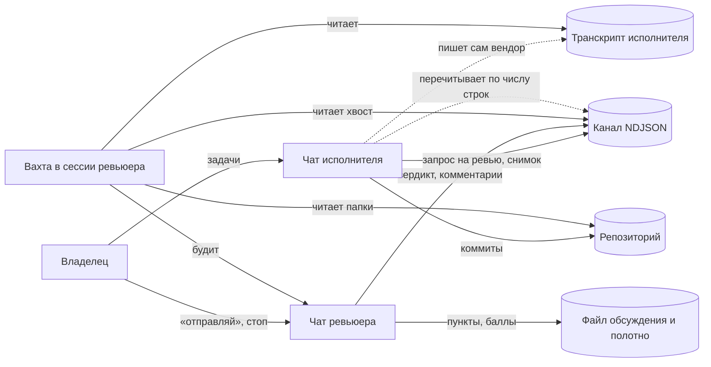
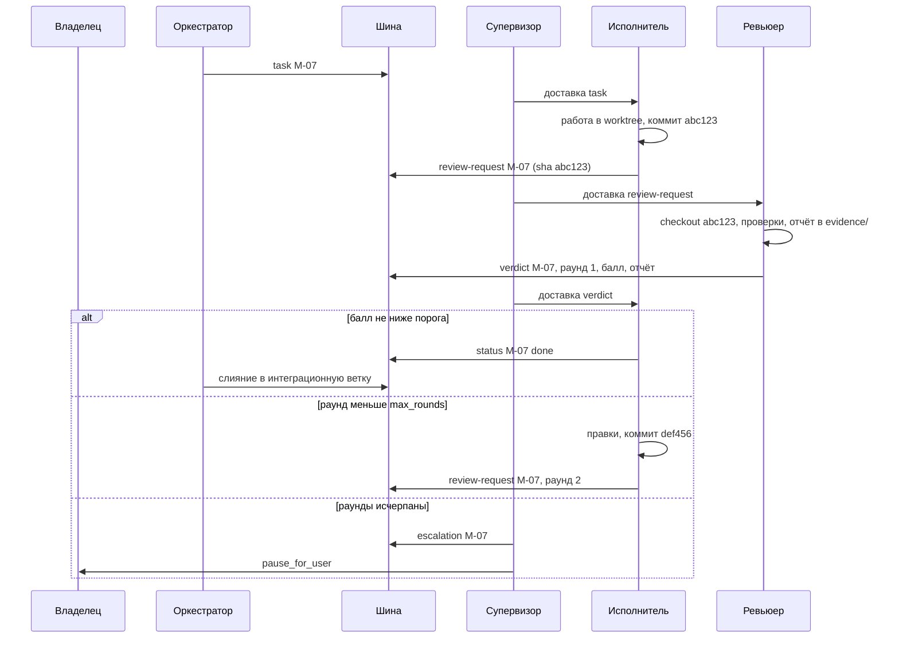

# Межчатовый харнесс: как устроена связка агентов сегодня и куда её вести

Статус: описание и целевая модель. Раздел 5 в пакете не реализован; раздел 6 показывает, куда он ляжет.

Документ описывает схему совместной работы двух и более агентов, каждый из которых живёт в своём чате у своего вендора, поверх одного репозитория. Схема снята с работающей связки. Пути, имена проектов и вендоров убраны, остались роли и механика. Цель: понять, что именно эта связка делает, и собрать то же самое как харнесс, где роли назначаются, привязываются к вендору и модели, а оркестратор управляет процессом через межчатовое общение с редактируемыми правами.

## 0. Словарь

- Владелец: человек. Единственный источник задач и последнее слово.
- Чат: одна сессия одного агента у одного вендора. Агент видит только свой чат.
- Роль: набор обязанностей, прав на запись в канал и инструкций. Сегодня две роли: исполнитель и ревьюер-представитель.
- Канал: общий файл, через который чаты обмениваются записями.
- Вахта: скрипт-наблюдатель, который опросом читает источники и будит агента при изменениях.
- Линия: один экземпляр связки для одного проекта: свой канал, свои вахты, свои документы.
- Веха: единица работы исполнителя, которая идёт на ревью целиком.

## 1. Как есть

### 1.1 Участники и распределение прав

Три участника: владелец, чат исполнителя, чат ревьюера.

| Участник | Что делает | Что видит | Кому пишет |
|---|---|---|---|
| Владелец | ставит задачи исполнителю напрямую в его чате; даёт ревьюеру команду «отправляй»; ставит маркер остановки | оба чата, канал, репозиторий | обоим агентам, в канал |
| Исполнитель | работает в дереве репозитория, готовит снимки вех, пишет в канал запросы на ревью и статусы | свой чат, канал (когда перечитывает), репозиторий | в канал |
| Ревьюер-представитель | наблюдает за исполнителем, проверяет вехи, пишет вердикты и комментарии; в канале выступает от имени владельца | свой чат, канал, транскрипт исполнителя, репозиторий | в канал, только по правилам права слова |

Ключевое свойство: единая цепочка команд. Задачи исполнителю ставит только владелец. Тексты ревьюера не содержат заданий исполнителю, даже если ревьюер видит, что нужно сделать. Владелец при этом сам выполняет роль маршрутизатора: он решает, что и когда попадает из одного чата в другой.

### 1.2 Канал: файл-шина

Канал это один файл NDJSON, только дописывание, одна запись это одна строка JSON.

| Поле | Смысл |
|---|---|
| `ts` | время записи |
| `seq` | сквозной порядковый номер в канале |
| `from`, `to` | роли отправителя и адресата |
| `kind` | тип записи: запрос на ревью, вердикт, комментарий, маркер остановки владельца и так далее |
| `ref` | ссылка на предмет: веха, пункт обсуждения, предыдущая запись |
| `text` | тело |
| `evidence` | пути к свидетельствам: отчёты, логи, манифесты |

Первая строка файла это протокол: правила канала, записанные в самом канале. Любой агент, открыв файл, узнаёт правила без внешних документов. Файл лежит вне дерева репозитория, чтобы не попадать в коммиты и диффы. Каждая линия проекта заводит свой файл; старые линии остаются архивом.

Что канал даёт: общий порядок событий, читаемость человеком, независимость от вендоров (любой агент умеет читать и дописывать файл), сохранность между сессиями.

Чего в нём нет: блокировки при записи, доставки адресату, подтверждения прочтения, проверки, что `from` действительно тот, кто пишет.

### 1.3 Право слова: политика связи в прозе

Право ревьюера писать в канал ограничено двумя маршрутами.

1. По слову владельца: владелец говорит «отправляй», ревьюер пишет одну запись.
2. Автоматически, в ответ на запись исполнителя вида «запрос на ревью»: ревьюер отвечает вердиктом без команды владельца. Порог принятия 9 из 10, не более трёх раундов на веху.

Плюс запрет по содержанию: в текстах ревьюера нет заданий исполнителю.

Это и есть политика связи: матрица «кто, кому, какие типы записей, по какому триггеру, с какими границами». Сегодня она живёт в инструкциях ролей и держится на послушании агента и надзоре владельца. Никакой механизм её не проверяет.

### 1.4 Вахты: наблюдение опросом

Ревьюер узнаёт о событиях через вахту: скрипт во временной папке его сессии, запущенный через инструмент мониторинга, раз в 20–60 секунд читает три источника.

1. Транскрипт исполнителя: файл сессии у вендора исполнителя, отфильтрованный по идентификатору треда и по типу записей «сообщение». Так ревьюер видит ход работы исполнителя, не заглядывая в его чат.
2. Хвост канала: новые строки с прошлого тика.
3. Заданные папки репозитория: подготовительные материалы и текущая ветка.

При изменении вахта будит ревьюера, и он реагирует. В предыдущей линии было два наблюдателя с файлами состояния и логами, плюс две вахты с тиком 15 минут: контрольная (жив ли процесс, согласовано ли состояние) и толковательная (пересказ владельцу, что делает исполнитель).

Асимметрия: ревьюер событийный, исполнитель нет. Исполнитель узнаёт о новых записях либо перечитывая канал по числу строк, либо из пересказа владельца. Ревьюер видит транскрипт исполнителя, исполнитель транскрипт ревьюера не видит.

### 1.5 Общие документы: медленный канал

Рядом с каналом два документа для длинных текстов.

- Файл обсуждения: пункты исполнителя, под каждым комментарий ревьюера с оценкой. Формат «пункт, комментарий, балл».
- Заметки на общем полотне рядом со схемой проекта, реплики в формате `[дата · роль] текст`.

Канал это короткие типизированные записи и указатели, документы это развёрнутая аргументация. Документы читают и люди, и агенты; машинно они не разбираются.

### 1.6 Ревью вехи: рукопожатие через снимок

Веха проходит ревью до коммита. Порядок:

1. Исполнитель кладёт во временную папку снимок: манифест с sha256 каждого файла, архив дерева и дифф относительно родительского коммита. В канал уходит запрос на ревью со ссылкой на веху.
2. Ревьюер сверяет sha256 из манифеста с архивом и с живым деревом исполнителя: снимок равен тому, что у исполнителя на диске.
3. Ревьюер клонирует родительский коммит в свою временную папку, накладывает снимок, гоняет проверки.
4. Ревьюер пишет вердикт в канал: балл, замечания, пути к свидетельствам. При балле ниже порога исполнитель правит и присылает новый снимок, до трёх раундов.
5. После коммита ревьюер сверяет дерево коммита с манифестом: в коммит попало ровно то, что прошло ревью.

Что здесь реализовано: передача незакоммиченной работы между чатами с проверкой целостности, воспроизведение в изоляции, ограниченный цикл ревью с числовым критерием, аттестация коммита после факта. Манифест и архив нужны только потому, что работа передаётся до коммита. В терминах git снимок это коммит, а манифест это хеш дерева.

### 1.7 Управляющие записи и линии

Остановка, пауза, смена правил идут той же шиной: маркер остановки владельца это обычная запись в канале. История управления и история работы лежат в одном журнале. Переход к новому проекту это новая линия: новый файл канала с новой первой строкой-протоколом, новые вахты, новые документы. Скилл и заметки хранят инструкцию, как собрать линию заново руками.

### 1.8 Схема потоков



## 2. Что эта связка реализует на самом деле

| Элемент связки | Что реализует | Чего не хватает |
|---|---|---|
| Файл NDJSON с `seq` | шина событий с общим порядком | атомарная выдача `seq`, доставка, подтверждение |
| Первая строка-протокол | самоописание канала для новых сессий | версионирование протокола |
| `from`, `to`, `kind`, `ref` | адресация, типизация, треды | закрытый список типов, проверка отправителя |
| `evidence` | указатели на свидетельства | долговечное место хранения |
| Право слова | политика связи по ролям | машинная проверка, правка без переписывания инструкций |
| Порог 9/10, три раунда | конечный цикл ревью с критерием | единая запись параметров цикла, эскалация при исчерпании |
| Вахты | событийная модель для ревьюера | долговечность, симметрия для всех ролей, состояние курсоров |
| Транскрипт исполнителя | наблюдаемость соседнего чата | канонический интерфейс чтения у каждого вендора |
| Снимок с манифестом | ревью до коммита с проверкой целостности | замена на объекты git |
| Файл обсуждения и полотно | длинная форма аргументации | связь с записями канала через `ref` |
| Маркер остановки | управляющая плоскость в том же журнале | полный набор управляющих типов |
| Владелец как маршрутизатор | ручной оркестратор с полным правом | передача роли оркестратора агенту |

## 3. Почему это костыль

| Факт | Обобщённый режим отказа | Требование к харнессу |
|---|---|---|
| Вахты живут во временной папке и умирают с перезагрузкой; сейчас ни одной не стоит | нет долговечного супервизора; процесс исчезает молча | супервизор как служба с состоянием на диске и автоперезапуском; отсутствие вахты видно |
| Исполнитель ничего не получает автоматически | нет доставки; событийность только у одной роли | доставка по курсорам каждому месту; общий механизм пробуждения |
| Ревьюер видит транскрипт исполнителя, обратного нет | асимметричная наблюдаемость | единый адаптер чтения транскрипта у каждого вендора; кто что видит, задаёт политика |
| `seq` каждый берёт сам без блокировки | гонка за номером, дубли, дырки | один аппендер, блокировка файла |
| Кириллица в heredoc блокируется, запись только скриптом | запись в канал не первоклассная операция | команда `send`, текст из файла, а не из аргументов оболочки |
| Реле и свидетельства прогонов во временной папке пропадают | недолговечные свидетельства | папка свидетельств в состоянии линии, не во временной папке |
| Контекст исполнителя ограничен окном, экспериментальный режим заметок с открытым дефектом | канал растёт быстрее, чем помещается в окно | дайджесты тредов, бутстрап новой сессии из протокола и дайджеста |
| `from` пишет сам отправитель | нет идентичности | токен места, аппендер проставляет `from` сам |
| Правила права слова в прозе | нет машинной проверки политики | политика в файле, проверка на аппендере, отказ с причиной |
| Линия собирается руками по заметкам | нет воспроизводимого запуска | `harness init` из манифеста команды |

## 4. Пользовательские пути сегодня (кратко)

1. Завести линию: создать файл канала с протоколом в первой строке, договориться о ролях, поднять вахты в сессии ревьюера.
2. Поставить задачу: владелец пишет исполнителю в его чат.
3. Наблюдать: вахта показывает ревьюеру ход работы; по толковательному тику ревьюер пересказывает владельцу.
4. Провести ревью вехи: снимок, запрос на ревью, проверка, вердикт, до трёх раундов, коммит, аттестация коммита.
5. Передать слово: владелец говорит «отправляй», ревьюер пишет в канал, владелец говорит исполнителю перечитать канал.
6. Вести обсуждение: исполнитель пишет пункты, ревьюер комментирует с баллами; реплики на полотне.
7. Остановить: маркер остановки владельца в канал, вахты сняты.
8. Восстановиться после перезагрузки: собрать вахты по скиллу заново, потерянные свидетельства прогнать повторно.

Пути 1, 5, 7 и 8 целиком ручные. Пути 3 и 4 полуавтоматические. Только путь 4 имеет формальные критерии.

## 5. Целевой харнесс

### 5.1 Требования

Из постановки:

1. Роли назначаются, а не зашиваются.
2. Роль передаётся конкретному вендору с конкретной моделью.
3. Оркестратор управляет процессом через межчатовое общение.
4. Межчатовое общение ограничено по ролям, и ограничения редактируются.
5. Вся команда работает над одним проектом: один воркфлоу, одна папка, один git.

Из раздела 3:

6. Долговечность: супервизор, канал и свидетельства переживают перезагрузку.
7. Доставка и симметрия: любое место получает адресованные ему записи.
8. Машинная политика: аппендер отказывает записи, нарушающей маршрут.
9. Воспроизводимый запуск линии из файлов в репозитории.

### 5.2 Объекты

- Проект: репозиторий и рабочая папка.
- Линия: состояние харнесса для проекта, папка `.harness/` в корне.
- Роль: имя, инструкции, права на маршруты, подписки на события.
- Место (seat): роль, привязанная к вендору, модели, рантайму, сессии и worktree. Одна роль может занимать несколько мест (два ревьюера у разных вендоров); одно место всегда одной роли.
- Владелец: человек, особое место `owner` с полным правом.
- Оркестратор: место с ролью управления. В начале это владелец, потом агент.
- Шина: канал, аппендер и доставка.
- Политика связи: матрица маршрутов.
- Супервизор: служба вахт.
- Тред: предмет обсуждения (задача, веха), значение поля `thread`.

### 5.3 Манифест команды

```yaml
# .harness/team.yaml
version: 1
project: <имя>
integration_branch: main
seats:
  owner:
    role: owner
    kind: human
  orchestrator:
    role: orchestrator
    vendor: <vendor>
    model: <model-id>
    runtime: <cli-or-sdk>
    worktree: .worktrees/orchestrator
    instructions: .harness/roles/orchestrator.md
    context_budget_tokens: 200000
  executor:
    role: executor
    vendor: <vendor>
    model: <model-id>
    runtime: <cli-or-sdk>
    worktree: .worktrees/executor
    instructions: .harness/roles/executor.md
    subscriptions: [inbox]
  reviewer:
    role: reviewer
    vendor: <vendor>
    model: <model-id>
    runtime: <cli-or-sdk>
    worktree: .worktrees/reviewer
    instructions: .harness/roles/reviewer.md
    subscriptions: [inbox, transcript:executor, paths:docs/, paths:src/]
```

Смена вендора или модели у роли это правка одного блока; инструкции роли не меняются. Это и есть «назначить роль, передать вендору с моделью».

### 5.4 Политика связи

```yaml
# .harness/comms-policy.yaml
version: 3
default: deny
kinds: [task, status, question, answer, review-request, verdict, blocker, escalation, note, stop, resume, digest]
routes:
  - from: owner
    to: "*"
    kinds: "*"
  - from: orchestrator
    to: executor
    kinds: [task, question, answer, stop, resume]
  - from: executor
    to: orchestrator
    kinds: [status, question, blocker, review-request]
  - from: executor
    to: reviewer
    kinds: [review-request, answer]
  - from: reviewer
    to: executor
    kinds: [verdict, question]
    trigger: reply-to:review-request
    bounds: {max_rounds: 3, accept_score: 9}
  - from: reviewer
    to: [orchestrator, executor]
    kinds: [note]
    trigger: owner-ack
  - from: "*"
    to: owner
    kinds: [escalation, status]
observe:
  reviewer: [transcript:executor]
  orchestrator: [transcript:executor, transcript:reviewer]
```

Как это воспроизводит сегодняшние правила:

- «пишу только по слову владельца»: `trigger: owner-ack`, запись ждёт в очереди, пока владелец не подтвердит её командой `harness ack <seq>`;
- «исключение: прямой ответ на запрос ревью, 9/10, три раунда»: маршрут с `trigger: reply-to:review-request` и `bounds`;
- «задания исполнителю не входят в мои тексты»: у ревьюера нет маршрута с `kind: task`, правило стало структурным, а не текстовым;
- «ревьюер видит транскрипт исполнителя, обратного нет»: секция `observe`.

Правки политики вступают в силу на следующем тике. Каждая правка сама попадает в канал записью `kind: policy` с номером версии, так что все места видят, что правила изменились, а по полю `policy` в каждой записи видно, по каким правилам она прошла.

### 5.5 Шина

Формат записи:

```json
{"seq": 194, "id": "01J9X…", "ts": "2026-09-13T10:15:00Z", "from": "executor", "to": "reviewer", "kind": "review-request", "thread": "M-07", "reply_to": null, "text": "…", "evidence": [".harness/evidence/M-07/r1/report.md"], "policy": 3}
```

Отличия от сегодняшнего канала: `thread` и `reply_to` вместо одного `ref`; `id` для ссылок, не зависящих от `seq`; `policy` как версия правил; закрытый список `kind`.

Аппендер: единственный писатель. Команда `harness send --to reviewer --kind review-request --thread M-07 --text-file msg.md --evidence <path>`:

1. читает токен места из окружения сессии и сама ставит `from`;
2. проверяет маршрут по политике; при отказе печатает причину агенту и пишет запись `kind: rejected` владельцу;
3. под блокировкой файла выдаёт `seq` и дописывает строку;
4. берёт текст из файла, поэтому ограничения оболочки на кириллицу и кавычки не мешают.

Первая строка остаётся протоколом: версия формата и ссылки на `team.yaml` и `comms-policy.yaml`.

Доставка: файл `.harness/state/cursors.json` хранит для каждого места последний доставленный `seq`. Супервизор на тике берёт записи с `to`, равным месту или `*`, выше курсора, и вталкивает их в чат места через адаптер вендора. Если у вендора нет способа втолкнуть сообщение, место само выполняет `harness inbox` в начале каждого хода. Это то же «перечитать канал по числу строк», но с курсором и без участия владельца.

### 5.6 Адаптеры сессий

Сегодня адаптеры пакета проецируют скиллы в формат вендора. Харнессу нужен второй слой адаптера: управление сессией. Для каждого вендора адаптер должен уметь пять операций.

| Операция | Зачем |
|---|---|
| `start(seat)` | поднять сессию с инструкциями роли и токеном места |
| `push(seat, text)` | доставить запись в чат |
| `transcript(seat, since)` | прочитать новые сообщения сессии, то, что сегодня вахта читает из файла сессии |
| `idle(seat)` | понять, что ход закончен и можно доставлять |
| `resume(seat)` | продолжить ту же сессию после перезапуска |

Если у вендора нет `push`, работает запасной путь `inbox` на старте хода. Если нет `transcript`, роль-наблюдатель для этого места невозможна, и секция `observe` политики должна это отражать. Таблица возможностей по вендорам заполняется по факту проверки, как в `docs/vendor-compatibility.md`, а не по предположению.

### 5.7 Супервизор

Одна служба на линию. Запускается как пользовательская служба ОС или под менеджером процессов, а не из временной папки сессии. Состояние на диске в `.harness/state/`. Цикл тика:

1. прочитать хвост канала;
2. для каждого места доставить новые записи по курсору;
3. для подписок `transcript:*` прочитать транскрипты через адаптеры и породить события;
4. для подписок `paths:*` проверить изменения в папках репозитория и ссылки git;
5. по таймерам породить контрольный тик (живы ли сессии, не завис ли тред дольше `timeout`) и толковательный тик (запрос дайджеста у назначенной роли);
6. записать курсоры.

Перезапуск начинается с курсоров: ничего не теряется и не доставляется дважды. Отсутствие живого супервизора видно в дашборде и в `harness status`.

### 5.8 Оркестратор

Роль оркестратора: читать план в `TASK-PLAN.md`, нарезать задачи, ставить их исполнителю записями `kind: task`, следить за статусами, запускать ревью, считать раунды, эскалировать владельцу при исчерпании `max_rounds` или по `timeout`, сводить веху в интеграционную ветку после прохождения.

Переход от владельца к агенту-оркестратору делается политикой, а не переписыванием ролей:

- этап 1: оркестратор пишет только владельцу, владелец пересылает вручную, как сегодня;
- этап 2: маршрут от оркестратора к исполнителю с `trigger: owner-ack`;
- этап 3: тот же маршрут без триггера.

Владелец в любой момент может занять любое место сам: `harness send --as executor` при праве `owner`.

### 5.9 Рабочее пространство

- Один репозиторий, одна интеграционная ветка.
- У каждого места-агента свой worktree и ветка `seat/<место>/<тред>`. Два агента не пишут в одно дерево.
- Веха это коммит на ветке места. Запрос на ревью ссылается на SHA.
- Ревьюер делает checkout этого SHA в своём worktree, гоняет проверки, кладёт отчёт в `.harness/evidence/<тред>/r<раунд>/` по контракту `Ran / Skipped / Planned / Manual` из `core/shared/reporting-contract.md`. Вердикт ссылается на SHA и отчёт.
- После прохождения слияние в интеграционную ветку делает оркестратор или исполнитель, по политике. Аттестация «в коммит попало ровно то, что прошло ревью» сводится к равенству SHA. Манифест, архив и sha256 по файлам больше не нужны.
- Если владелец требует ревью до любого коммита, снимок это `git format-patch` относительно базового SHA, и в `evidence` лежит один файл с его sha256. Это сегодняшний метод, сжатый до одного файла. Рекомендуется первый вариант.
- В git: `team.yaml`, `comms-policy.yaml`, `protocol.md`, `roles/*.md`. Вне git, но в долговечном месте: `state/channel.ndjson`, `state/cursors.json`, `evidence/`, `digests/`. Так один проект получает ровно одну линию, а перенос проекта переносит и историю связки.

### 5.10 Ревью вехи в целевой схеме



Параметры цикла (`max_rounds`, `accept_score`, `timeout`) живут в политике и совпадают с полями `max_review_loops` и `escalation_rule` в `TASK-PLAN.md`.

### 5.11 Контекстный бюджет

Канал растёт быстрее окна любой модели. Поэтому:

- при закрытии треда роль-суммаризатор или оркестратор пишет `digests/<тред>.md` и запись `kind: digest`;
- новая сессия места стартует с протокола, `team.yaml`, своих маршрутов из политики, открытых тредов, последнего дайджеста и последних N записей, а не с полного канала;
- у каждого места есть `context_budget_tokens`; супервизор считает объём доставленного и предупреждает оркестратора, когда пора закрыть тред и перезапустить сессию.

### 5.12 Пользовательские пути в целевом харнессе (кратко)

1. `harness init`: создаёт `.harness/`, протокол, пустые манифест и политику из шаблона.
2. Правка `team.yaml` и `comms-policy.yaml`: назначить роли, привязать вендоров и модели, задать маршруты.
3. `harness up`: супервизор поднимает сессии мест через адаптеры и начинает тики.
4. `harness send --to orchestrator --kind task`: владелец ставит задачу, дальше оркестратор ведёт сам.
5. `harness status` и производный дашборд: кто на ком ждёт, открытые треды, раунды, живы ли места.
6. Вмешательство: `harness ack`, `harness send --kind stop`, правка политики, занятие роли вручную.
7. Ревью вехи идёт по разделу 5.10 без участия владельца, эскалация приходит владельцу.
8. Перезагрузка: `harness up` продолжает с курсоров, свидетельства на месте.

## 6. Где это ложится в этот репозиторий

Пакет уже содержит части харнесса, только без транспорта между чатами.

| Есть в пакете | Роль в харнессе |
|---|---|
| `senior-ui-ux-orchestrator` | инструкции роли оркестратора для предметной области |
| `task-plan-v2-orchestrator`: `owner_role`, `agent_sequence`, `agent_contracts`, `max_review_loops`, `escalation_rule` | источник задач и параметров цикла ревью |
| `workflow-compliance-supervisor`, `scripts/append_workflow_log.py`, `scripts/validate_workflow_log.py` | прообраз аппендера с проверкой схемы и запретом секретов; журнал решений |
| `core/shared/reporting-contract.md`, `scripts/validate_evidence_report.py` | формат и проверка свидетельств ревьюера |
| `agent-progress-visualizer` и принцип «производный вид, не источник правды» | дашборд харнесса поверх канала |
| `adapters/*` | место для второго слоя адаптеров: управление сессией |
| `data/journey-registry.json`, поле `enforcement_policy` по стадиям | где в воркфлоу гейт ревью обязателен |

Предлагаемое расположение новых частей:

```text
harness/
├── README.md                 # ссылка на этот документ
├── templates/
│   ├── team.example.yaml
│   ├── comms-policy.example.yaml
│   ├── protocol.md
│   └── roles/{orchestrator,executor,reviewer}.md
└── scripts/
    ├── harness_bus.py        # send / inbox / ack: аппендер, курсоры, политика
    ├── harness_supervisor.py # тики, доставка, подписки, состояние
    └── adapters/<vendor>.py  # start / push / transcript / idle / resume
```

Порядок внедрения: сначала аппендер и политика (снимают гонку `seq`, самодельную запись и правила в прозе), затем супервизор с курсорами (снимает недолговечность и асимметрию), затем адаптеры вендоров по одному, затем оркестратор-агент.

## 7. Открытые решения

1. Оркестратор: сразу агент или владелец с постепенным снятием `owner-ack`? Рекомендация: этапы из раздела 5.8.
2. Ревью до коммита или ревью коммита? Рекомендация: ревью коммита на ветке места.
3. Канал внутри проекта в `.harness/state/` или рядом с проектом? Рекомендация: внутри, вне git.
4. Какие вендоры дают `push` и `transcript`? Заполняется проверкой; до этого работает `inbox` на старте хода.
5. Нужна ли цепочка хешей записей для защиты от правки истории? Не в первой версии.
